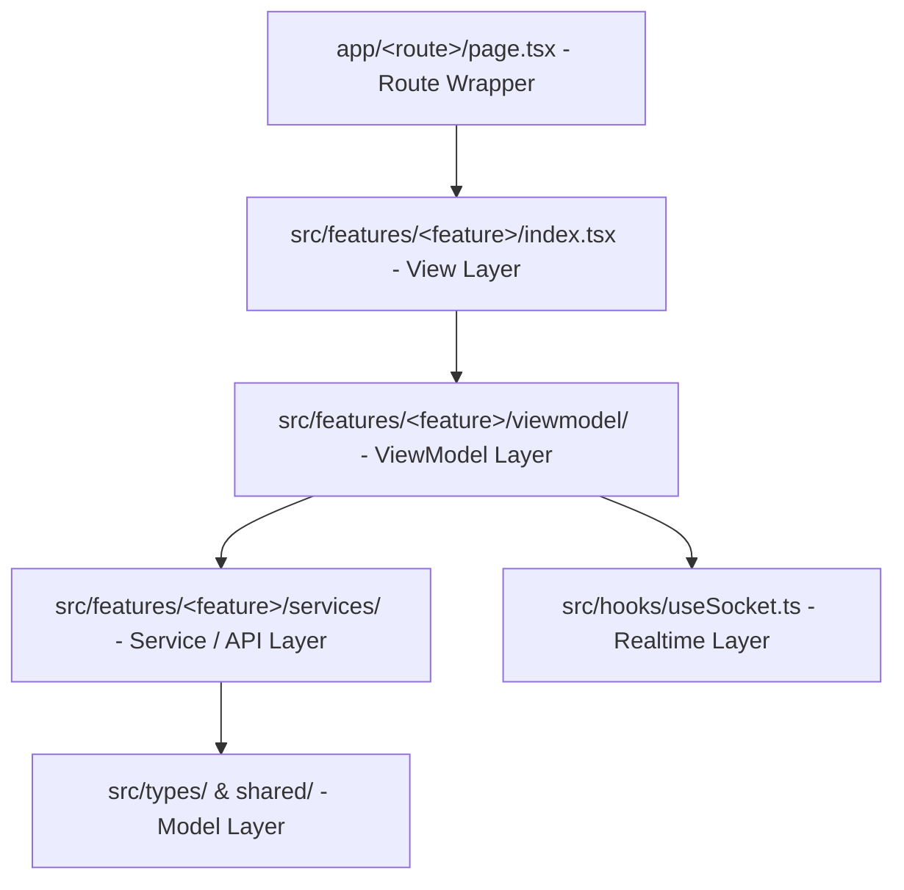

# Smart Quetta Hotel — Developer Guide & Coding Standards

Welcome to the **Smart Quetta Hotel** codebase! This document serves as the complete guide for developers on the **Architecture, Coding Patterns, Directory Structure, and Implementation Rules** (*"Feature yeh hai, iska saara maal yahan hai"*).

---

## 🏛️ 1. Core Architecture: Feature-Based MVVM + Services

The application follows the **Feature-Based MVVM (Model - View - ViewModel + Service)** architectural pattern. Every feature is 100% self-contained inside `src/features/<feature-name>/`.

```text
smart-quetta-hotel/
├── app/                             ➔ Next.js App Router (Root routes & layout)
│   ├── globals.css                  (Tailwind & Global design tokens)
│   ├── layout.tsx                   (Root layout + Fonts + Providers)
│   ├── providers.tsx                (tRPC, React Query, Theme & Lang Contexts)
│   ├── StaffNavBar.tsx              (Staff Navigation Bar)
│   ├── page.tsx                     (Route: / ➔ Customer Portal)
│   ├── dashboard/page.tsx           (Route: /dashboard ➔ Admin Dashboard)
│   ├── kitchen/page.tsx             (Route: /kitchen ➔ Kitchen KDS)
│   ├── waiter/page.tsx              (Route: /waiter ➔ Waiter Delivery)
│   ├── portal/page.tsx              (Route: /portal ➔ Legacy redirect/portal)
│   └── not-found.tsx                (Route: 404 Not Found)
│
├── src/                             ➔ Clean Domain & Feature Code
│   ├── features/                    ➔ Feature Modules (Self-contained)
│   │   ├── customer-portal/         (Menu, Cart, Ordering & Multi-language)
│   │   │   ├── services/customerService.ts
│   │   │   ├── viewmodel/useCustomerViewModel.ts
│   │   │   ├── components/
│   │   │   └── index.tsx
│   │   ├── dashboard/               (Cashier, Stock, KPIs, Payments & PIN Auth)
│   │   │   ├── services/dashboardService.ts
│   │   │   ├── viewmodel/useDashboardViewModel.ts
│   │   │   ├── components/
│   │   │   └── index.tsx
│   │   ├── kitchen/                 (Kitchen KDS, Item Status & Audio Alerts)
│   │   │   ├── services/kitchenService.ts
│   │   │   ├── viewmodel/useKitchenViewModel.ts
│   │   │   └── index.tsx
│   │   ├── waiter/                  (Waiter Delivery, Serving & Table Management)
│   │   │   ├── services/waiterService.ts
│   │   │   ├── viewmodel/useWaiterViewModel.ts
│   │   │   └── index.tsx
│   │   ├── portal/                  (Legacy landing/redirect)
│   │   └── not-found/               (404 Presentation)
│   │
│   ├── components/                  ➔ Shared Active UI Components & Primitives
│   │   ├── DashboardPinGate.tsx
│   │   ├── DepartmentForm.tsx
│   │   ├── DepartmentSelect.tsx
│   │   ├── ErrorBoundary.tsx
│   │   ├── FloatingAddButton.tsx
│   │   ├── LangSwitcher.tsx
│   │   ├── Logo.tsx
│   │   ├── NavBar.tsx
│   │   ├── NewOrderSheet.tsx
│   │   ├── ProductForm.tsx
│   │   └── ui/                      (alert-dialog, button, card, dialog, drawer, dropdown-menu, input, sonner, tooltip)
│   │
│   ├── contexts/                    ➔ LangContext (8 languages) & ThemeContext
│   ├── hooks/                       ➔ useSocket, useMobile, useComposition (Urdu IME)
│   ├── lib/                         ➔ trpc client, consts, dashboardAuth, time (Karachi TZ), utils
│   └── types/                       ➔ hotel.ts (Domain models)
│
├── api/                             ➔ Backend Server (Express 5, tRPC, Drizzle SQLite, Sockets)
├── shared/                          ➔ Shared Types, Constants & Schemas (@shared/*)
└── public/                          ➔ Static Assets (PWA Icons, Local Fonts, Audio SFX)
```

---

## 🧩 2. The 5 Layers & Coding Pattern

Our codebase strictly enforces separation of concerns across 5 distinct layers:



### Layer 1: Model (`src/types/hotel.ts` & `shared/`)
- **Responsibility:** Pure TypeScript definitions and Zod schemas.
- **Rules:** No React hooks, no API calls, no UI logic.

### Layer 2: Service (`src/features/<feature>/services/<name>Service.ts`)
- **Responsibility:** Encapsulates all network queries & mutations (`trpc.hotel.*`).
- **Rules:** 
  - Exposes clean React Query hooks (e.g. `ordersQuery`, `createOrderMutation`).
  - Handles cache invalidation automatically on mutation success.
  - Does **not** contain UI state (no `useState` for modals/tabs).

### Layer 3: ViewModel (`src/features/<feature>/viewmodel/use<Name>ViewModel.ts`)
- **Responsibility:** The brain of the feature.
- **Rules:**
  - Calls the feature's Service hook.
  - Manages UI state (`activeTab`, `searchQuery`, `modalOpen`, `selectedId`).
  - Subscribes to realtime WebSocket events via `useSocket()`.
  - Exposes computed data and action handler functions (e.g. `handlePlaceOrder()`, `toggleFilter()`).
  - Returns a clean, flat object `return { ... }`.

### Layer 4: View (`src/features/<feature>/index.tsx` & `components/`)
- **Responsibility:** Pure visual presentation.
- **Rules:**
  - One line at top: `const vm = use<Name>ViewModel();`
  - Zero direct API calls (`trpc` is **NEVER** called directly in a View).
  - Uses `vm.prop` for data and `vm.handleAction` for event triggers.

### Layer 5: Next.js Route (`app/<route>/page.tsx`)
- **Responsibility:** URL route binding and SSR hydration boundary.
- **Rules:**
  - Uses `next/dynamic` with `{ ssr: false }` to prevent hydration mismatches on local PIN hashes and guest storage.

---

## 📝 3. How to Write Code (Step-by-Step Example)

Whenever adding or modifying a feature, follow this exact 4-step template:

### Step 1: Create the Service (`src/features/sample/services/sampleService.ts`)
```typescript
import { trpc } from "@/lib/trpc";

export function useSampleService() {
  const utils = trpc.useUtils();

  const itemsQuery = trpc.hotel.getProducts.useQuery();

  const createItemMutation = trpc.hotel.createProduct.useMutation({
    onSuccess: () => {
      utils.hotel.getProducts.invalidate();
    },
  });

  return {
    items: itemsQuery.data ?? [],
    isLoading: itemsQuery.isLoading,
    refetch: itemsQuery.refetch,
    createItem: createItemMutation.mutateAsync,
  };
}
```

### Step 2: Create the ViewModel (`src/features/sample/viewmodel/useSampleViewModel.ts`)
```typescript
import { useState } from "react";
import { useSampleService } from "../services/sampleService";
import { useSocket } from "@/hooks/useSocket";
import { toast } from "sonner";

export function useSampleViewModel() {
  const service = useSampleService();
  const [searchTerm, setSearchTerm] = useState("");

  // Realtime Socket Sync
  const socket = useSocket();
  useEffect(() => {
    if (!socket) return;
    const onUpdate = () => service.refetch();
    socket.on("product_update", onUpdate);
    return () => { socket.off("product_update", onUpdate); };
  }, [socket]);

  // Derived / Filtered data
  const filteredItems = service.items.filter(item => 
    item.name.toLowerCase().includes(searchTerm.toLowerCase())
  );

  // Actions
  const handleCreate = async (name: string, price: number) => {
    try {
      await service.createItem({ name, price });
      toast.success("Item created successfully!");
    } catch (err: any) {
      toast.error(err.message || "Failed to create item");
    }
  };

  return {
    isLoading: service.isLoading,
    items: filteredItems,
    searchTerm,
    setSearchTerm,
    handleCreate,
  };
}
```

### Step 3: Create the View (`src/features/sample/index.tsx`)
```tsx
"use client";

import { useSampleViewModel } from "./viewmodel/useSampleViewModel";
import { useLang } from "@/contexts/LangContext";
import { Button } from "@/components/ui/button";

export default function SampleView() {
  const vm = useSampleViewModel();
  const { t } = useLang();

  if (vm.isLoading) return <div>Loading...</div>;

  return (
    <div className="p-6">
      <input 
        value={vm.searchTerm} 
        onChange={(e) => vm.setSearchTerm(e.target.value)} 
        placeholder={t("search")} 
      />
      <div className="grid gap-4 mt-4">
        {vm.items.map((item) => (
          <div key={item.id} className="p-4 border rounded">
            <h3>{item.name}</h3>
            <p>Rs. {item.price}</p>
          </div>
        ))}
      </div>
    </div>
  );
}
```

### Step 4: Create the Next.js Route (`app/sample/page.tsx`)
```tsx
"use client";

import dynamic from "next/dynamic";

const SampleView = dynamic(() => import("@/features/sample"), {
  ssr: false,
});

export default function SamplePage() {
  return <SampleView />;
}
```

---

## 🎯 4. Coding Rules & Best Practices

1. **Strict Path Aliases:**
   - Always use `@/` for files under `src/` (e.g. `@/features/customer-portal`, `@/components/ui/button`, `@/lib/trpc`).
   - Always use `@shared/` for files under `shared/` (e.g. `@shared/const`, `@shared/types`).
   - Never use deep relative paths like `../../../../src/components`.

2. **Multilingual (8 Languages) & Urdu First:**
   - Always wrap user-facing text with `t("key")` from `useLang()`.
   - Use `dir={isRtl ? "rtl" : "ltr"}` for proper RTL rendering (Urdu, Pashto, Balochi, Arabic, Sindhi, Saraiki, Farsi).

3. **Realtime Socket Cleanliness:**
   - Always remove socket listeners in the cleanup return function of `useEffect` to prevent memory leaks and duplicate notifications.

4. **Zero Untyped `any`:**
   - Always type function arguments and responses with interfaces from `@/types/hotel` or `@shared/*`.

---

## 🛠️ 5. Developer CLI Commands

```bash
# Start Next.js + Socket.io Server (Development)
npm run dev

# TypeScript Typecheck (Zero Errors Allowed)
npm run check

# Run Automated Unit Tests (Vitest)
npm run test

# Production Build (Next.js App Router + esbuild Node bundle)
npm run build

# Start Production Server
npm run start
```
