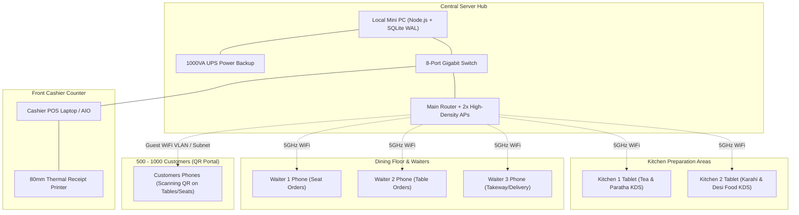

# Smart Quetta Hotel — Hardware, Networking & Deployment Guide
**Location Context:** Multan, Pakistan  
**Scale Target:** 500 – 1,000 Concurrent Peak Users / Guests  
**Topology:** 1 Cashier Counter + 2 Kitchen KDS Departments (Tea/Paratha & Karahi/Main) + Multiple Waiters + Self-Ordering QR Guests

---

## 1. Role-Wise Hardware & Device Requirements

| Role / Station | Recommended Device | Min Specs | Recommended Models (Pak Market / OLX) | Est. Price (PKR - OLX / Local Market) |
| :--- | :--- | :--- | :--- | :--- |
| **Main Local Server** *(Brain of the Hotel)* | Mini PC / SFF Desktop or Core i5 Laptop | Core i5 (6th-8th Gen), 16GB RAM, 256GB NVMe SSD, Gigabit LAN | Dell OptiPlex 7050 Micro / HP ProDesk Mini / Lenovo ThinkCentre M710q | **Rs. 22,000 – 35,000** |
| **Counter / Cashier POS** | 15"–19" All-in-One PC / Touchscreen Monitor or Laptop | Core i3/i5, 8GB RAM, 128GB SSD | Dell Inspiron / HP Touch AIO / Posiflex / Any Laptop | **Rs. 20,000 – 35,000** |
| **Kitchen Department 1** *(Tea & Paratha)* | 10"–12" Android Tablet or Wall-Mounted Monitor | Android 10+, 3GB/4GB RAM, WiFi 5GHz | Lenovo Tab M10 / Samsung Galaxy Tab A7 / A8 | **Rs. 18,000 – 28,000** |
| **Kitchen Department 2** *(Karahi / Main Food)* | 10"–12" Android Tablet or Wall-Mounted Monitor | Android 10+, 3GB/4GB RAM, WiFi 5GHz | Lenovo Tab M10 / Samsung Galaxy Tab A8 / 19" LED with TV Stick | **Rs. 18,000 – 28,000** |
| **Waiters (Per Waiter)** | 6.5" Android Smartphone or 7" Compact Tablet | Android 11+, 3GB/4GB RAM, Fast Touchscreen | Redmi 10C / 12C, Infinix Hot series, Tecno Spark, or 2nd-hand Samsung | **Rs. 15,000 – 22,000** per device |
| **Thermal Receipt Printer** | 80mm USB / Ethernet Thermal POS Printer | Auto-Cutter, 200–260mm/s speed, ESC/POS | Xprinter XP-N160M / XP-Q800 / Rongta 80mm | **Rs. 11,000 – 16,000** |
| **WiFi Access Points** *(For 500-1000 Users)* | Dual-Band High-Density Gigabit Access Points | AC1200 / AX1800 Dual Band (2.4GHz + 5GHz), 250+ clients per AP | TP-Link EAP225 / EAP610 Outdoor/Indoor or Ruijie Reyee RG-RAP2200 | **Rs. 18,000 – 32,000** each (2 APs needed) |
| **UPS / Backup Power** | 600VA–1000VA Offline UPS for Server & Router | Pure Sine Wave / Fast Switching (<10ms) | Homage / APC / EcoStar 1000VA | **Rs. 14,000 – 25,000** |

---

## 2. Recommended Physical Setup & Device Placement (Topology)

---

## 3. How 500 – 1,000 Users Are Handled Without Lag or Crashes

### 1. Local LAN Hosting (Zero Internet Dependency)
- The entire system runs inside the hotel's local network (`192.168.1.xxx` or `hotel.local`).
- If PTCL / Nayatel / Jazz internet goes down, **billing, kitchen tickets, customer QR ordering, and waiter apps continue running at 100% speed without interruption**.

### 2. High-Performance SQLite WAL Mode (Write-Ahead Logging)
- `sqlite.pragma("journal_mode = WAL")` is enabled in `api/db/index.ts`.
- **Readers do not block writers, and writers do not block readers**. Hundreds of customers browsing the menu concurrently do not slow down the cashier printing bills or kitchen preparing food.

### 3. Lightweight Single-Page App (SPA) Architecture
- Next.js & React bundle static assets once in the guest's mobile browser cache.
- Placing an order only transmits a tiny JSON payload (**< 2 KB**), taking less than **15 milliseconds** over local WiFi.

### 4. High-Density WiFi Network Configuration
- To support 500–1000 devices at the hotel, the standard PTCL router alone is not enough.
- **Recommended Network Config:**
  - Standard Router connected to **2x TP-Link Omada EAP225 or Ruijie Reyee RG-RAP2200 Access Points**.
  - Setup Subnet with `/22` netmask (e.g. `192.168.0.1/22`), allowing **1,022 simultaneous IP addresses** without running out of DHCP lease.
  - Separate **Staff SSID** (5GHz priority for Cashier, Kitchen, Waiter) and **Guest WiFi SSID** (isolated, no access to admin panel).

---

## 4. Guarantee Against Order Mix-Ups (سافٹ ویئر کوئی مکس اپ کیوں نہیں کرے گا؟)

1. **Unique Atomic Order IDs & Ticket Numbers:**
   - Every order has an auto-incrementing unique integer `id` and unique `orderNo` (e.g. `#1042`).
   - Every dining guest visit gets an independent session UUID and `seatingNo` (e.g. `Table 4`, `Seat S-12`).

2. **Automated Department-Level Kitchen Routing:**
   - When a customer orders **Chai + Anda Paratha + Chicken Karahi**:
     - *Chai & Paratha* automatically route exclusively to **Kitchen 1 (Tea & Paratha Tablet)**.
     - *Chicken Karahi* automatically routes exclusively to **Kitchen 2 (Karahi/Main Kitchen Tablet)**.
   - Chefs only see items relevant to their department, eliminating kitchen confusion.

3. **Multi-Counter & Cashier Isolation:**
   - Every order records the exact `counterName` (e.g. `Counter 1`, `Takeaway Desk`) and `cashierId`.
   - Z-Reports, Day Close audit logs, and cash drawers calculate totals separately per station.

4. **Multi-Device Live Sync via WebSockets:**
   - When a kitchen chef marks an item as *"Ready"*, the Waiter's phone buzzes and lights up with table location immediately.
   - When the Cashier receives payment, the bill status updates instantly across all connected screens.

---

## 5. Summary Budget Breakdown (Estimates in PKR - Multan Market)

| Item | Qty | Unit Price (PKR) | Total (PKR) |
| :--- | :---: | :--- | :--- |
| Dell / HP Micro Mini PC (Server) | 1 | Rs. 26,000 | Rs. 26,000 |
| Cashier Laptop / AIO Desktop | 1 | Rs. 28,000 | Rs. 28,000 |
| Kitchen Tablets (Lenovo 10.1") | 2 | Rs. 22,000 | Rs. 44,000 |
| Waiter Smartphones (Infinix / Redmi) | 3 | Rs. 18,000 | Rs. 54,000 |
| 80mm Thermal Receipt Printer (Xprinter) | 1 | Rs. 13,500 | Rs. 13,500 |
| High-Density Access Points (TP-Link EAP225) | 2 | Rs. 20,000 | Rs. 40,000 |
| 1000VA UPS Backup | 1 | Rs. 18,000 | Rs. 18,000 |
| Wall Mounts, Cables & Stands | - | Rs. 6,500 | Rs. 6,500 |
| **Grand Total Estimated Hardware Budget** | | | **~ Rs. 230,000** |
