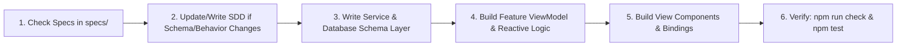

# 📜 Smart Quetta Hotel — Spec-Driven Development (SDD) Master Index

Welcome to the **Specification & Design Document (SDD)** directory for the **Smart Quetta Hotel** software ecosystem. All architectural, database, UI/UX, and operational features are formally specified here to ensure standard-compliant **Spec-Driven Development (SDD)**.

---

## 📑 Specification Index

| Document ID | Title | Domain / Focus | Status |
| :--- | :--- | :--- | :--- |
| [**SDD-001**](./SDD-001-SYSTEM-ARCHITECTURE.md) | **System Architecture & Stack** | 5-Layer MVVM+Services, Next.js App Router, Express 5, tRPC, WebSockets | `APPROVED / ACTIVE` |
| [**SDD-002**](./SDD-002-DATABASE-SCHEMA.md) | **Database Schema & Full ERD** | SQLite (WAL Mode), Drizzle ORM, 18 Tables, Full Mermaid ER Diagram | `APPROVED / ACTIVE` |
| [**SDD-003**](./SDD-003-POS-AND-KHATA-SYSTEM.md) | **POS Terminal & Market Khata** | Shopkeeper Accounts, Pre-Order Confirmation Modal, Dual Settlement | `APPROVED / ACTIVE` |
| [**SDD-004**](./SDD-004-CUSTOMER-PORTAL-AND-CAPTIVE-FLOW.md) | **Customer Portal & Captive Flow** | Name & Phone capture, Smart Upsells, Product-Aware Kitchen Notes | `APPROVED / ACTIVE` |
| [**SDD-005**](./SDD-005-LOCALIZATION-8-LANGUAGES.md) | **8-Language Localization Matrix** | Centralized Dictionary, RTL Engine (`en, ur, ps, bal, brh, fa, pa, sd`) | `APPROVED / ACTIVE` |
| [**SDD-006**](./SDD-006-UI-UX-DESIGN-SYSTEM-GUIDE.md) | **UI/UX & Human Psychology Guide** | 1-Thumb Touch Targets, Audio Feedback, Chai Palette, Zero Cognitive Friction | `APPROVED / ACTIVE` |
| [**SDD-007**](./SDD-007-CODING-PATTERNS-AND-STRUCTURE.md) | **Coding Patterns & Architecture** | 5-Layer MVVM+Services, Directory Standards, Strict TypeScript & Invariants | `APPROVED / ACTIVE` |

---

## 🎯 Spec-Driven Development (SDD) Workflow

Developers working on this repository MUST follow the SDD workflow:

1. **Specs as the Source of Truth:**
   - Any new feature, table, or route must first have an updated or new specification file in `specs/`.
2. **Layered Separation:**
   - No direct `trpc` network calls in Views. Network calls go inside `services/`, business state inside `viewmodel/`, and layout inside `components/` and `index.tsx`.
3. **Multilingual Compliance:**
   - No hardcoded English or Urdu strings in UI components. All text must map to keys in `src/contexts/LangContext.tsx` with all 8 supported languages provided.
4. **Zero-Lock Concurrency & Pre-Order Review:**
   - SQLite WAL mode must be preserved.
   - Orders must never be punched into the database before explicit user/cashier review and confirmation.
