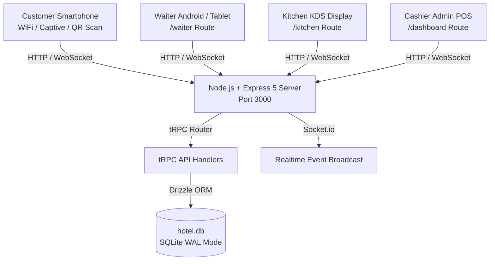
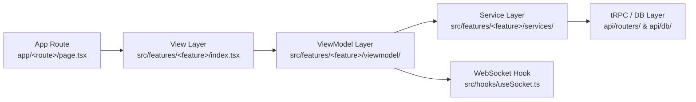

# 🏛️ SDD-001: System Architecture & Technology Stack

- **Document ID**: `SDD-001`
- **Feature Area**: Core Infrastructure & Application Architecture
- **Status**: `APPROVED / ACTIVE`
- **Revision**: `2.0.0`

---

## 1. High-Level Architecture Overview

Smart Quetta Hotel is an offline-capable, high-speed, local-area hospitality software platform engineered for Quetta tea stalls, dhabas, and modern cafes. It connects customers, waiters, kitchen staff, and cashiers in real time with sub-10ms latency over local WiFi.

---

## 2. Technology Stack

| Layer | Technology | Rationale |
| :--- | :--- | :--- |
| **Framework** | Next.js 16 (App Router) + React 19 | Fast PWA capabilities, static route optimization, modern hooks |
| **Backend & RPC** | Express 5 + tRPC v11 | Type-safe end-to-end client-server bridge without REST boilerplate |
| **Database & ORM** | SQLite 3 (`better-sqlite3`) + Drizzle ORM | Zero-setup, instant local backup, WAL mode for concurrent readers/writers |
| **Realtime Engine** | Socket.io 4.8 | Instant event delivery for KDS, Waiter delivery alerts, and live POS totals |
| **Styling & Design** | Tailwind CSS v4 + Lucide Icons | Clean, fat-finger touch friendly, high contrast, responsive UI |
| **Audio Alerts** | HTML5 Audio (`public/tap.mp3`, `order-success.mp3`) | Audio feedback on touch and order status shifts |

---

## 3. The 5-Layer MVVM + Service Architectural Pattern

All domain code in `src/features/<feature>/` strictly enforces separation into 5 layers:

### Layer Responsibilities
1. **Model Layer (`src/types/` & `shared/`)**: Zod validation schemas and TypeScript types.
2. **Service Layer (`services/<name>Service.ts`)**: Encapsulates React Query and tRPC mutations/queries with automatic cache invalidation.
3. **ViewModel Layer (`viewmodel/use<Name>ViewModel.ts`)**: State management, computed properties, socket event listeners, and business logic actions.
4. **View Layer (`index.tsx` & `components/`)**: Pure JSX representation consuming `const vm = useViewModel()`. Zero direct `trpc` calls allowed.
5. **Next.js App Route (`app/<route>/page.tsx`)**: Route boundary using `next/dynamic` with `{ ssr: false }` for client-only state persistence.

---

## 4. Concurrency & Performance Guarantees

1. **WAL Mode (Write-Ahead Logging)**:
   - Readers never block writers, and writers never block readers.
2. **Offline Local Resilience**:
   - The system functions 100% on local LAN without requiring an active external internet connection.
3. **Zero Hydration Mismatches**:
   - `suppressHydrationWarning` on `<body>` to prevent browser extension injections from disrupting React hydration.
