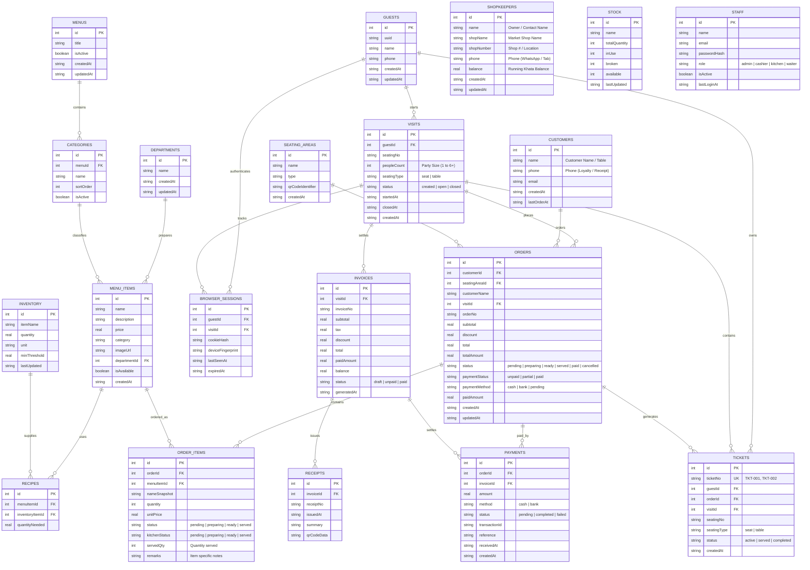

# 🗄️ SDD-002: Complete Database Schema & Entity-Relationship Model

- **Document ID**: `SDD-002`
- **Feature Area**: Database Schema, Drizzle ORM Models, Foreign Keys & Indices
- **Status**: `APPROVED / ACTIVE`
- **Revision**: `2.0.0`

---

## 1. Full Entity-Relationship Diagram (ERD)



---

## 2. Table Specifications & Constraints

### 1. `shopkeepers` (Market Shopkeepers & Khata Accounts)
```typescript
export const shopkeepers = sqliteTable("shopkeepers", {
  id: int("id").primaryKey({ autoIncrement: true }),
  name: text("name").notNull(),
  shopName: text("shopName").notNull(),
  shopNumber: text("shopNumber"),
  phone: text("phone"),
  balance: real("balance").default(0).notNull(),
  createdAt: text("createdAt").default(sql`(datetime('now'))`).notNull(),
  updatedAt: text("updatedAt").default(sql`(datetime('now'))`).notNull(),
});
```

### 2. `customers` (Dine-in / Walk-in / Loyalty Guests)
```typescript
export const customers = sqliteTable("customers", {
  id: int("id").primaryKey({ autoIncrement: true }),
  name: text("name").notNull(),
  phone: text("phone"),
  email: text("email"),
  createdAt: text("createdAt").default(sql`(datetime('now'))`).notNull(),
  lastOrderAt: text("lastOrderAt").default(sql`(datetime('now'))`).notNull(),
});
```

### 3. `orders` & `order_items`
```typescript
export const orders = sqliteTable("orders", {
  id: int("id").primaryKey({ autoIncrement: true }),
  customerId: int("customerId").references(() => customers.id),
  seatingAreaId: int("seatingAreaId").references(() => seatingAreas.id),
  customerName: text("customerName"),
  visitId: int("visitId").references(() => visits.id),
  orderNo: text("orderNo"),
  subtotal: real("subtotal").default(0),
  discount: real("discount").default(0),
  total: real("total").default(0),
  totalAmount: real("totalAmount").default(0),
  status: text("status").default("pending").notNull(),
  paymentStatus: text("paymentStatus").default("unpaid").notNull(),
  paymentMethod: text("paymentMethod").default("pending"),
  paidAmount: real("paidAmount").default(0),
  createdAt: text("createdAt").default(sql`(datetime('now'))`).notNull(),
  updatedAt: text("updatedAt").default(sql`(datetime('now'))`).notNull(),
});
```
