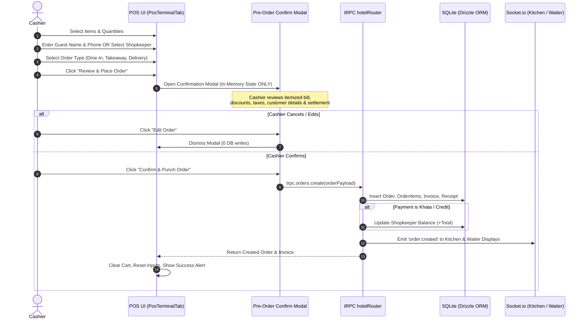

# 📋 SDD-003: POS Terminal & Market Shopkeeper Khata System

| Specification ID | SDD-003 |
| :--- | :--- |
| **Title** | **POS Terminal, Market Shopkeepers Khata & Pre-Order Confirmation** |
| **Status** | `APPROVED / ACTIVE` |
| **Layer / Component** | `src/features/dashboard/components/PosTerminalTab.tsx`, `api/routers/hotelRouter.ts`, `db/schema.ts` |
| **Last Updated** | 2026-09-11 |

---

## 1. Overview & Business Context

In Quetta and surrounding commercial bazaar hubs, local hotels frequently cater to two primary customer archetypes:
1. **Walk-in Table Guests & Takeaway Patrons**: Require standard instant payments (Cash / Online) with customer profile tracking (Name & Phone).
2. **Local Market Shopkeepers (*Dukan Daar*)**: Regularly order chai, paratha, and meals sent to their shops on credit (*Khata / Udhar*), settled on weekly or monthly cycles.

This specification governs the cashier **POS Terminal**, **Pre-Order Confirmation Modal Flow**, and the **Market Shopkeepers Khata System**.

---

## 2. Order Lifecycle & Pre-Order Confirmation Architecture

### 2.1 Critical Safety Principle: No Premature DB Mutations
> **CRITICAL INVARIANT:** An order MUST NEVER be inserted into the SQLite database (`orders`, `order_items`, `invoices`, `receipts`) when the cashier clicks "Place Order" or selects items in the cart. DB mutations occur **ONLY AFTER** the cashier confirms the complete breakdown in the **Pre-Order Confirmation Modal**.



---

## 3. Market Shopkeeper Khata (*Dukan Daar*) Schema & Mechanics

### 3.1 Shopkeeper Data Structure
```typescript
// db/schema.ts
export const shopkeepers = sqliteTable('shopkeepers', {
  id: text('id').primaryKey(),               // nanoId / uuid
  name: text('name').notNull(),              // e.g. "Haji Abdul Rahim"
  phone: text('phone').notNull(),             // e.g. "03001234567"
  shopNumber: text('shop_number').notNull(),  // e.g. "Shop # 14, Cloth Market"
  marketName: text('market_name').notNull(),  // e.g. "Liaquat Bazaar"
  balance: real('balance').notNull().default(0.0), // Running ledger balance (PKR)
  creditLimit: real('credit_limit').notNull().default(50000.0), // Maximum allowed credit
  isActive: integer('is_active', { mode: 'boolean' }).notNull().default(true),
  notes: text('notes'),
  createdAt: text('created_at').notNull()
});
```

### 3.2 Dual Customer Identification in POS
The POS Terminal accommodates two input modes seamlessly:
1. **Registered Shopkeeper Selection**:
   - Cashier selects an existing shopkeeper from the smart dropdown.
   - Automatically populates `Customer Name`, `Customer Phone`, and tags the order with `shopkeeperId`.
   - Displays current running balance and credit limit.
2. **Walk-in Guest Direct Input**:
   - Cashier inputs `Customer Name` and `Customer Phone` directly.
   - If not yet in `customers` table, `getOrCreateCustomer` automatically upserts the record on punch.
3. **In-POS Quick Registration**:
   - A dedicated modal allows creating a new `shopkeeper` record directly within the POS screen without navigating away.

---

## 4. Dual Settlement Flow (Cash vs. Khata)

| Settlement Mode | Invoice Status | Balance Effect | Receipt Description |
| :--- | :--- | :--- | :--- |
| **Cash / Online** | `PAID` | None | Instant settlement; receipt printed with cash tendered and change. |
| **Shopkeeper Khata (Credit)** | `UNPAID` / `CREDIT` | `shopkeepers.balance += orderTotal` | Account debited; receipt shows shopkeeper name, shop number, and updated balance. |

---

## 5. UI/UX & Responsive Layout Specifications

### 5.1 Desktop Layout (`>= 1024px`)
- **Left Panel (65%)**: Category pills + Menu item cards grid with stock badges, prices, and fast click-to-add.
- **Right Panel (35%)**: Sticky cart pane containing:
  - Customer Name & Phone inputs + Shopkeeper dropdown picker.
  - Itemized cart with quantity modifiers (`+` / `-` / `trash`).
  - Subtotal, Tax, and Grand Total summary.
  - Large Primary Action: "Review & Place Order" button.

### 5.2 Mobile / Small Screen Layout (`< 1024px`)
- **Header**: Compact brand title + 8-language switcher + table selector.
- **Body**: Scrollable menu cards grid.
- **Floating Bottom Bar**: Shows cart item count & total price with an "Open Cart" button.
- **Slide-up Cart Sheet**: Full cart drawer containing customer inputs, order items, and checkout trigger.
- **Full-Screen / Centered Modal**: Pre-Order Confirmation Modal with safe touch targets (`>= 48px`).

---

## 6. Verification & Automated Tests

1. **Unit & API Tests (`tests/pos-khata.test.ts`)**:
   - Verify `getOrCreateCustomer` creates or updates customer phone.
   - Verify `orders.create` handles both `cash` and `khata` settlement.
   - Verify shopkeeper balance increments accurately upon credit order punch.
2. **UI Inspection & Linter**:
   - `npm run check` (zero TypeScript errors).
   - `npm test` (all tests passing).
