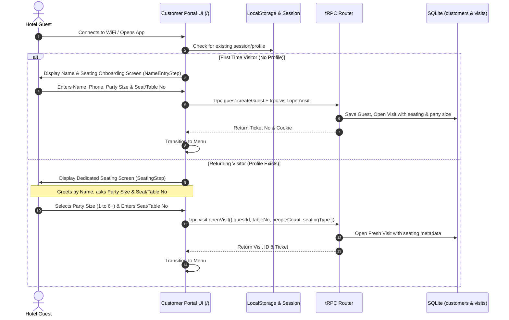
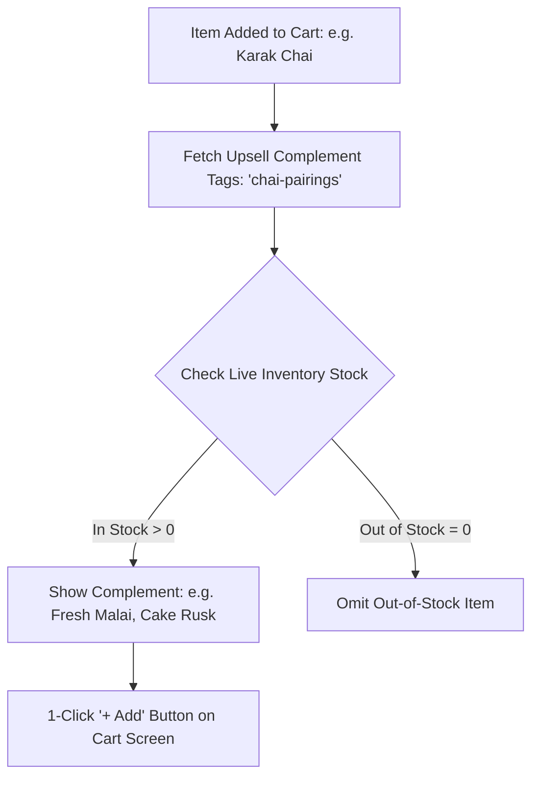

# 📋 SDD-004: Customer Portal & Captive WiFi Flow

| Specification ID | SDD-004 |
| :--- | :--- |
| **Title** | **Customer Portal, Captive Flow, Smart Upsells & Product-Aware Kitchen Notes** |
| **Status** | `APPROVED / ACTIVE` |
| **Layer / Component** | `src/features/customer-portal/`, `src/features/customer-portal/components/ConfirmPlaceModal.tsx`, `api/routers/hotelRouter.ts` |
| **Last Updated** | 2026-09-11 |

---

## 1. Overview & Objectives

The **Customer Portal** (`/`) is the public interface served when guests scan a QR code on their dining table or connect to the hotel's Captive WiFi network.

### Primary Objectives:
1. **Captive WiFi Identity Capture**: Seamlessly collect Guest Name and Phone Number to personalize greetings and track loyalty.
2. **Single Seating Number Field & Dynamic Classification**:
   - ONE unified seating number field is used.
   - Based on party size:
     - If `peopleCount === 1`: Automatically labeled & formatted as **Seat No / Chair #** (`سیٹ نمبر`, e.g. `Seat 1`).
     - If `peopleCount > 1`: Automatically labeled & formatted as **Table No** (`ٹیبل نمبر`, e.g. `Table 4`).
   - Customer Name is a separate dedicated field.
3. **Per-Order Multiple Ticket Architecture**:
   - A single customer can place multiple orders over time.
   - Each order generates its own unique Ticket Number (`orderNo: TKT-xxx`).
   - Allows guests to order more items (e.g. 2nd round of tea/parathas) with independent ticket tracking in Order History, KDS, and Waiter views.
4. **Product-Aware Kitchen Notes**: Provide context-specific instruction chips tailored to Pakistani dining habits (e.g., *Karak, Kam Cheeni, Extra Crispy*).
5. **Dynamic In-Stock Upsells**: Recommend relevant pairings (e.g., *Malai with Chai*, *Raita with Biryani*) filtered strictly by real-time inventory availability.
6. **Pre-Order Confirmation Modal**: Prevent accidental taps from dispatching premature orders.

---

## 2. Onboarding & Returning Customer Flow



---

## 3. Product-Aware Smart Kitchen Notes

Pakistani hotel patrons have distinct culinary preferences depending on what they order. The portal dynamically renders quick-selection tag chips based on the active item category:

| Item Category | Quick Tag Chips (Multi-lingual) | Custom Note Input |
| :--- | :--- | :--- |
| **Tea & Chai** | `Karak (Strong)`, `Kam Cheeni (Low Sugar)`, `Bina Cheeni (Sugar Free)`, `Extra Elaichi`, `Doodh Patti` | Optional free-form text box |
| **Paratha & Naan** | `Crispy / Karara`, `Kam Tail (Less Oil)`, `Makkhan Uper (Butter Topping)`, `Tandori` | Optional free-form text box |
| **Karahi & Handi** | `Spicy / Teekha`, `Normal Masala`, `Kam Mirch (Mild)`, `Bina Adrak (No Ginger)` | Optional free-form text box |
| **Rice & Biryani** | `Double Masala`, `Single Boti`, `Sada Chawal`, `Extra Gravy` | Optional free-form text box |

```typescript
// Example Tag Extraction Helper
export function getSmartNotesForCategory(categoryId: string, lang: SupportedLang): string[] {
  // Returns localized smart note chips tailored for the selected product
}
```

---

## 4. Dynamic In-Stock Upsell Engine

When an item is added to the cart, the portal evaluates complement pairings from active menu items:



### Upsell Invariants:
1. **Zero Out-of-Stock Exposure**: Items whose `stock_quantity <= 0` must never appear in recommendations.
2. **Non-Intrusive**: Displayed as clean horizontal scroll cards under the active cart breakdown.

---

## 5. Portal Pre-Order Confirmation Modal Flow

Just like the POS Terminal, the Customer Portal incorporates a mandatory pre-order confirmation modal (`src/features/customer-portal/components/ConfirmPlaceModal.tsx`):
- Summarizes Table Number, Item list, Custom Notes, and Grand Total.
- Requires deliberate user tap on `"Order Now"` before dispatching `trpc.orders.create`.
- On success, smoothly transitions to real-time order tracking with Live Status (`PENDING -> PREPARING -> READY -> SERVED`).

---

## 6. Verification & Quality Gates

- **Hydration Safety**: Use persistent client-safe hooks (`useHasMounted`) to avoid SSR mismatch on LocalStorage reads.
- **RTL & LTR Support**: Form fields, chips, and modals properly reverse layouts for Urdu, Pashto, Balochi, Brahui, Sindhi, and Persian.
- **Automated Tests**:
  - Verify `ConfirmPlaceModal` triggers submit handler with intact custom notes.
  - Verify in-stock upsell filter discards items with zero stock.
