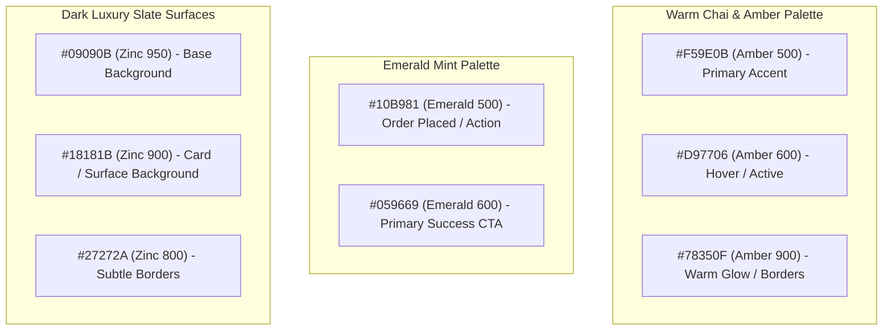

# 🎨 SDD-006: UI/UX Design System & Human Psychology Guide

| Specification ID | SDD-006 |
| :--- | :--- |
| **Title** | **UI/UX Design System, Ergonomics, Human Psychology & Micro-Interactions** |
| **Status** | `APPROVED / ACTIVE` |
| **Layer / Focus** | Design System, Components, Layouts, Audio Feedback, Psychology |
| **Last Updated** | 2026-09-11 |

---

## 1. Design Philosophy & Human Psychology

The software ecosystem for **Smart Quetta Hotel** is engineered specifically for **non-technical, naive, elderly, and multilingual patrons and cashier staff**. In bustling Pakistani food street environments, order placement must be effortless, intuitive, and accomplishable within **3 to 5 seconds**.

### Core UX Tenets:
1. **Zero Cognitive Load**: Visual thumbnails, cultural icons, and prominent badges eliminate the need to read detailed text.
2. **1-Thumb Ergonomics**: Mobile touch targets are concentrated in the natural thumb zone (lower 40% of the screen).
3. **Multi-Sensory Feedback**: Visual state updates, pulse animations, and synthesized tactile audio chimes confirm every action.
4. **Zero Accidental Mutations**: Explicit confirmation dialogs prevent double-clicks or accidental orders.

---

## 2. Color Palette & Design Tokens



### 2.1 Palette Specifications
- **Primary Brand (Chai Amber)**: Evokes the warm, hospitable atmosphere of traditional Quetta tea houses (`amber-500` / `amber-600`).
- **Success & Action (Emerald Mint)**: High-contrast call-to-action buttons (`emerald-500` / `emerald-600`) signaling order confirmation and paid statuses.
- **Surface & Dark Mode (Zinc & Slate)**: Deep, OLED-friendly dark themes (`zinc-950` to `zinc-800`) minimizing glare in bright daylight or dimly lit evening tea gardens.
- **Warning & Khata (Amber / Yellow)**: Used for credit balances, pending orders, and table badges.
- **Destructive (Crimson Red)**: Used strictly for deleting items, canceling orders, or clearing carts (`red-500` / `red-600`).

---

## 3. Typography & Multi-Script Font Rules

The application supports **8 languages** across Nastaliq, Arabic, and Latin alphabets.

### 3.1 Font Stack Hierarchy
```css
/* Urdu, Pashto, Balochi, Brahui, Persian, Punjabi (Shahmukhi), Sindhi */
font-family: system-ui, 'Noto Nastaliq Urdu', 'Noto Sans Arabic', 'Segoe UI', Tahoma, sans-serif;

/* Latin / English / Numerical Values */
font-family: 'Inter', 'Outfit', system-ui, -apple-system, sans-serif;
```

### 3.2 Script Scaling & Line Heights
- **Urdu / Arabic Glyphs**: Require `1.2x` to `1.3x` larger line-height (`leading-relaxed` or `leading-loose`) to prevent diacritics (zer, zabar, pesh, dots) from being clipped.
- **Font Size Bump**: Urdu text should be sized 1 step higher than equivalent English text (e.g., if English is `text-sm`, Urdu should be `text-base` for equal legibility).

---

## 4. Layout Architecture & Ergonomics

### 4.1 Mobile Viewport (< 1024px)
- **Sticky Top Bar**: Compact brand logo, active table badge, and 8-language switcher.
- **Horizontal Category Pills**: Smooth horizontal scrolling with active category glow.
- **1-Tap Food Cards**: High-density cards featuring large item images, Urdu & English titles, bold price in PKR, and instant `+` buttons.
- **1-Tap Bulk Multipliers**: Quick buttons for `+1`, `+2`, `+5` enabling fast bulk ordering for tea tables without repetitive tapping.
- **Floating Cart Footer**: Positioned at `bottom-0`, pulsating green bar displaying item count, subtotal, and single-tap checkout trigger.

### 4.2 Desktop & Tablet POS Viewport (>= 1024px)
- **100vh Locked Kiosk**: Zero window-level page scrolling.
- **Dual-Pane Grid**:
  - **Left Area (65%)**: Menu categories and touch-friendly product tiles.
  - **Right Area (35%)**: Viewport-pinned live register sidebar containing customer name/phone inputs, market shopkeeper selector, order items list, itemized subtotals, and punch actions.

---

## 5. Tactile Audio Feedback (Web Audio API)

To reassure non-tech users and busy cashiers without requiring visual confirmation, synthetic audio cues are integrated using the Web Audio API (`src/lib/sound.ts`):

```typescript
// 1. Tactile Tap Feedback (20ms micro-click)
export function playTapSound() {
  // Synthesizes a soft 600Hz -> 300Hz sine chirp
}

// 2. Order Success Celebration Chime
export function playOrderSuccessSound() {
  // Synthesizes a pleasant 3-note ascending arpeggio (E5 -> G#5 -> B5)
}
```

### Sound Guidelines:
- Sounds are non-blocking and fail gracefully if the browser restricts autoplay before user interaction.
- Sound duration must be under 300ms to prevent audio clutter during rapid item additions.

---

## 6. Cultural Conversion Badges & Visual Signals

Every dish and beverage card is enriched with emotional and cultural badges:

| Badge Type | Icon & Text (Urdu) | Purpose |
| :--- | :--- | :--- |
| **Bestseller** | `🔥 سب سے مقبول` | Guides naive/new patrons to popular items instantly |
| **Hotel Special** | `⭐ ہوٹل اسپیشل` | Highlights high-margin signature dishes (e.g. Special Doodh Patti) |
| **Fresh Batch** | `♨️ تازہ پکا ہوا` | Reassures freshness for parathas and karahi |
| **Stock Alert** | `⚠️ محدود اسٹاک` | Creates urgency and prevents out-of-stock ordering |

---

## 7. Component Checklist for UI Developers

- [ ] All clickable buttons have minimum touch dimensions of `48px x 48px` on mobile.
- [ ] Every button includes visible hover, active, and focus rings (`focus:ring-2 focus:ring-amber-500`).
- [ ] No hardcoded text strings; all text uses `t('key')` from `useLang()`.
- [ ] Layout dynamically mirrors for RTL languages (`dir="rtl"`).
- [ ] Every order submission step triggers the Pre-Order Confirmation Modal before dispatching API mutations.
