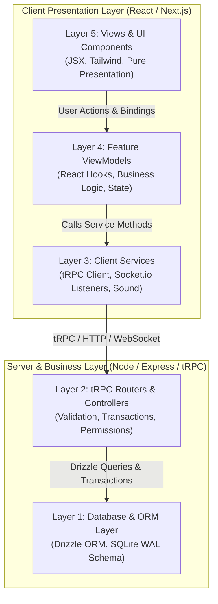

# 💻 SDD-007: Coding Patterns & Architecture Structure Guide

| Specification ID | SDD-007 |
| :--- | :--- |
| **Title** | **5-Layer MVVM + Services Pattern, Directory Structure & Coding Standards** |
| **Status** | `APPROVED / ACTIVE` |
| **Layer / Focus** | Architecture, Coding Standards, Directory Layout, State Management |
| **Last Updated** | 2026-09-11 |

---

## 1. Architectural Philosophy: The 5-Layer MVVM + Services Pattern

To maintain a scalable, testable, and maintainable codebase, all features must strictly follow the **5-Layer MVVM + Services Pattern**:



---

## 2. Directory Structure Standard

```
smart-quetta-hotel/
├── api/                             # Server Layer
│   ├── db/
│   │   ├── schema.ts                # Drizzle SQLite table definitions & types
│   │   └── index.ts                 # SQLite connection singleton (WAL mode)
│   ├── routers/
│   │   ├── hotelRouter.ts           # Orders, Khata, Menus, Inventory routers
│   │   ├── authRouter.ts            # Authentication & session procedures
│   │   └── index.ts                 # Root AppRouter export
│   ├── middleware/                  # Captive portal & auth middleware
│   └── trpc.ts                      # tRPC context, middleware & base procedures
│
├── specs/                           # Spec-Driven Development (SDD) Documents
│   ├── README.md                    # Master SDD Index & Workflow
│   ├── SDD-001-SYSTEM-ARCHITECTURE.md
│   ├── SDD-002-DATABASE-SCHEMA.md
│   ├── SDD-003-POS-AND-KHATA-SYSTEM.md
│   ├── SDD-004-CUSTOMER-PORTAL-AND-CAPTIVE-FLOW.md
│   ├── SDD-005-LOCALIZATION-8-LANGUAGES.md
│   ├── SDD-006-UI-UX-DESIGN-SYSTEM-GUIDE.md
│   └── SDD-007-CODING-PATTERNS-AND-STRUCTURE.md
│
├── src/                             # Client Layer
│   ├── app/                         # Next.js App Router (pages & layouts)
│   │   ├── page.tsx                 # Customer Portal root
│   │   ├── dashboard/page.tsx       # Cashier / Admin POS dashboard
│   │   ├── kitchen/page.tsx         # Kitchen Display System (KDS)
│   │   ├── waiter/page.tsx          # Waiter tablet terminal
│   │   └── layout.tsx               # Global root layout with LangProvider
│   │
│   ├── contexts/                    # Global Contexts (LangContext, ThemeContext)
│   ├── features/                    # Feature Modules (MVVM Encapsulation)
│   │   ├── customer-portal/
│   │   │   ├── components/          # MenuSection, ConfirmPlaceModal, CartBottomBar
│   │   │   ├── viewmodel/           # useCustomerViewModel.ts
│   │   │   └── index.tsx            # Feature entrypoint
│   │   ├── dashboard/
│   │   │   ├── components/          # PosTerminalTab, OrdersTab, StockTab, KhataTab
│   │   │   ├── viewmodel/           # useDashboardViewModel.ts
│   │   │   └── index.tsx
│   │   ├── kitchen/
│   │   └── waiter/
│   │
│   ├── services/                    # Client Services (Network & Socket bridges)
│   └── lib/                         # Utilities (sound.ts, trpc.ts, utils.ts)
│
├── tests/                           # Vitest Unit & Integration test suites
├── server.ts                        # Custom Express 5 + Socket.io entrypoint
└── drizzle.config.ts                # Drizzle kit configuration
```

---

## 3. Strict Coding Conventions & Rules

### Rule 1: No Direct Network Calls in View Components
- ❌ **Forbidden in Views**:
  ```tsx
  // Inside a component:
  const order = await trpc.orders.create.useMutation();
  ```
- ✅ **Mandatory Pattern**:
  Encapsulate in ViewModel (`usePosViewModel` or `useCustomerViewModel`):
  ```tsx
  // Inside ViewModel:
  export function usePosViewModel() {
    const createOrderMutation = trpc.orders.create.useMutation();
    const handlePunchOrder = async (payload: OrderPayload) => {
      // Validation & sound triggering
      return await createOrderMutation.mutateAsync(payload);
    };
    return { handlePunchOrder, isPending: createOrderMutation.isPending };
  }
  ```

### Rule 2: Strict TypeScript Types & Zero `any`
- Every request payload, response model, and DB entity must have explicit TypeScript typing derived from Drizzle schema schemas:
  ```typescript
  export type Shopkeeper = typeof shopkeepers.$inferSelect;
  export type NewShopkeeper = typeof shopkeepers.$inferInsert;
  export type OrderWithItems = Order & { items: OrderItem[]; invoice?: Invoice };
  ```

### Rule 3: Client-Side Hydration Protection
- Reading `localStorage` or `window` on initial render can trigger React Hydration mismatches.
- Always guard client-only properties with a mounted state check:
  ```tsx
  export function useHasMounted() {
    const [mounted, setMounted] = useState(false);
    useEffect(() => { setMounted(true); }, []);
    return mounted;
  }
  ```

### Rule 4: Atomic Transactions for Order Creation
- When an order is placed, inserting into `orders`, `order_items`, `invoices`, `receipts`, and updating `shopkeepers.balance` MUST be wrapped in a Drizzle transaction:
  ```typescript
  await db.transaction(async (tx) => {
    await tx.insert(orders).values(orderData);
    await tx.insert(orderItems).values(itemsData);
    await tx.insert(invoices).values(invoiceData);
    if (isKhata) {
      await tx.update(shopkeepers)
        .set({ balance: sql`${shopkeepers.balance} + ${totalAmount}` })
        .where(eq(shopkeepers.id, shopkeeperId));
    }
  });
  ```

---

## 4. Testing & Verification Standard

Every pull request or new feature branch must satisfy the three automated gates:

```bash
# Gate 1: Strict TypeScript type checking
npm run check

# Gate 2: Automated Unit & Integration Tests
npm test

# Gate 3: Production Build verification
npm run build
```
